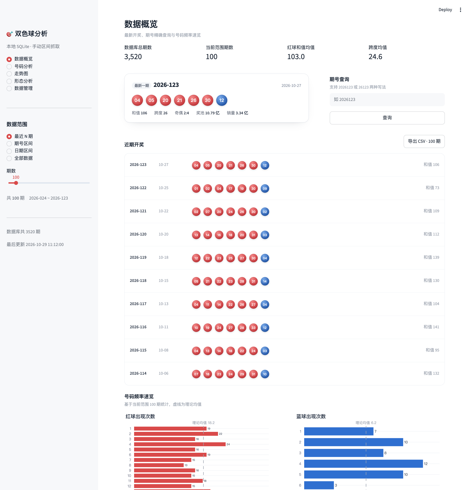
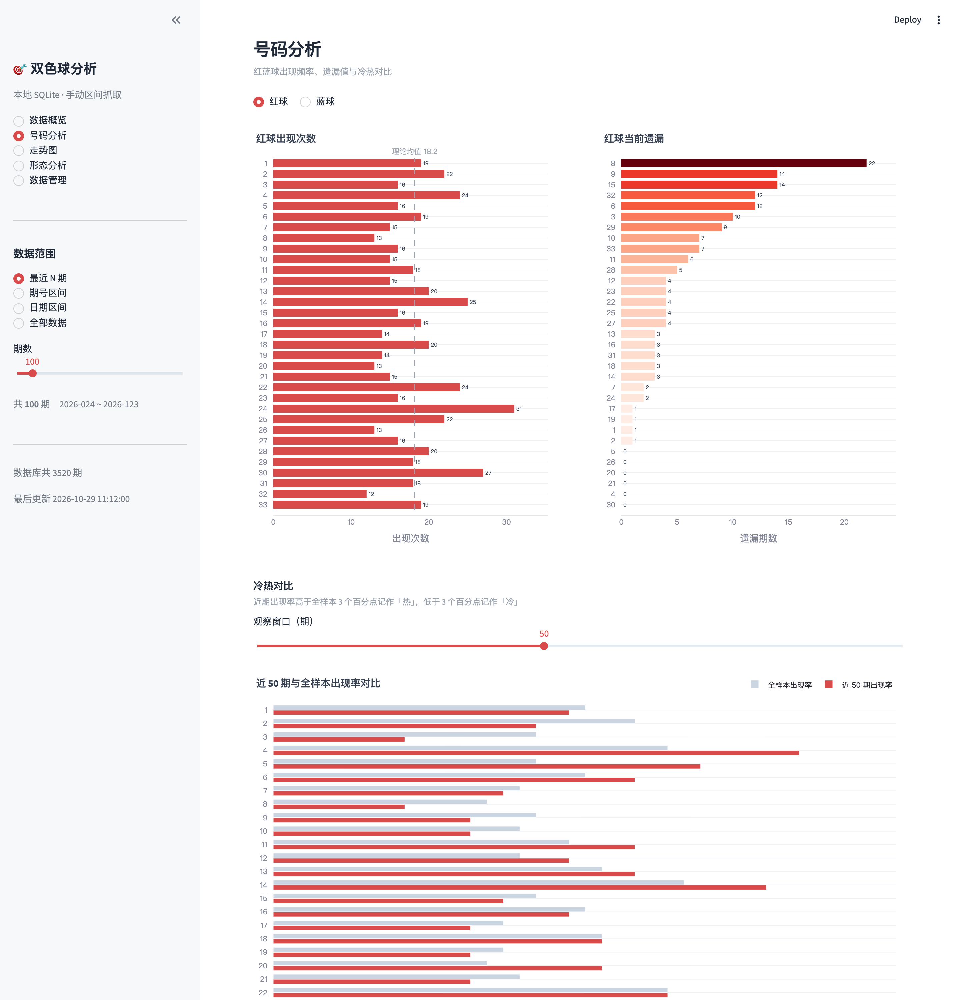
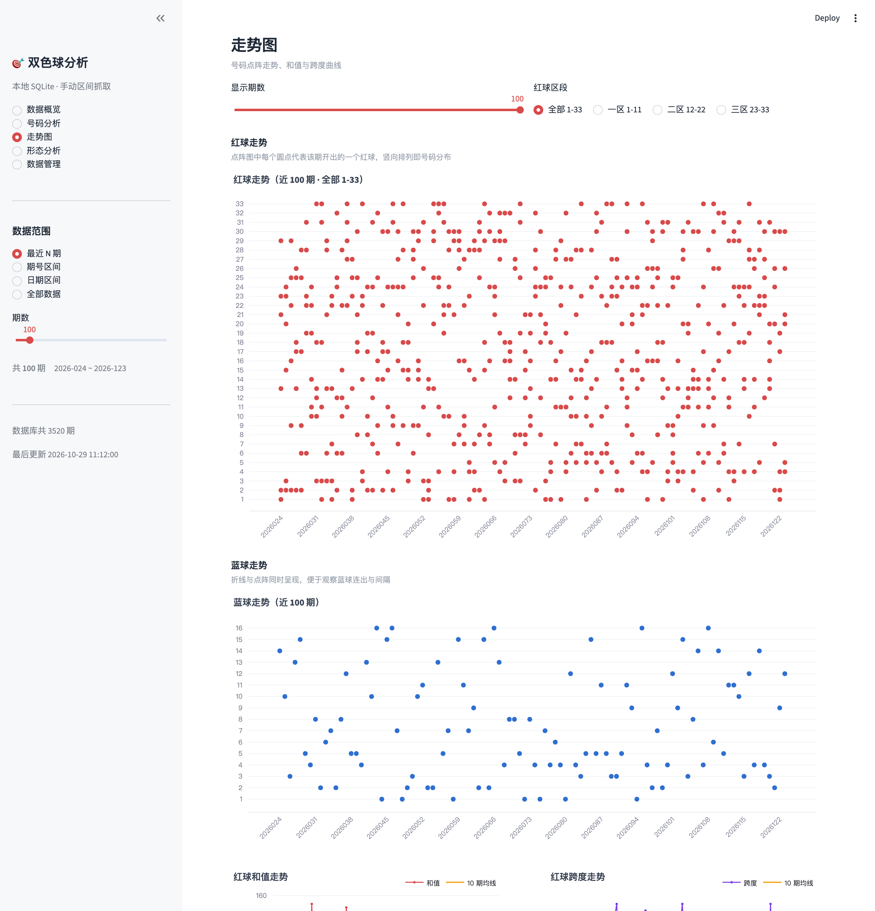
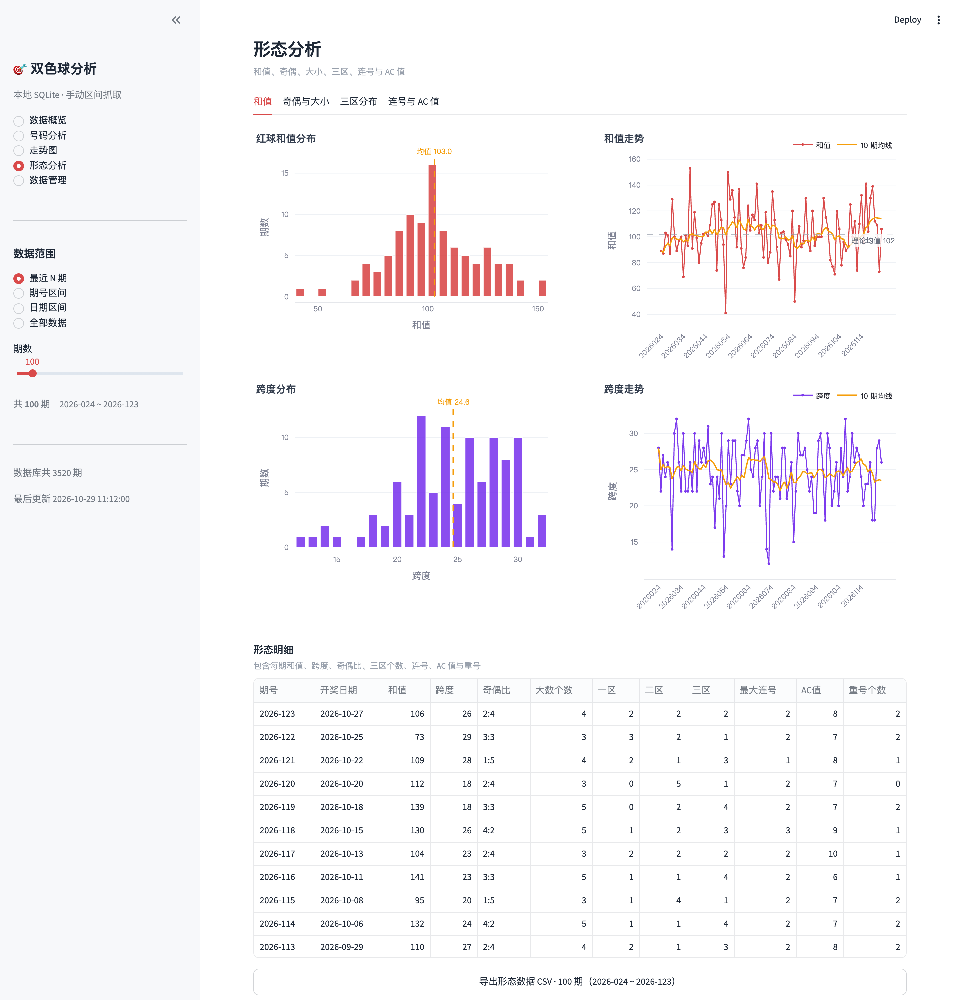
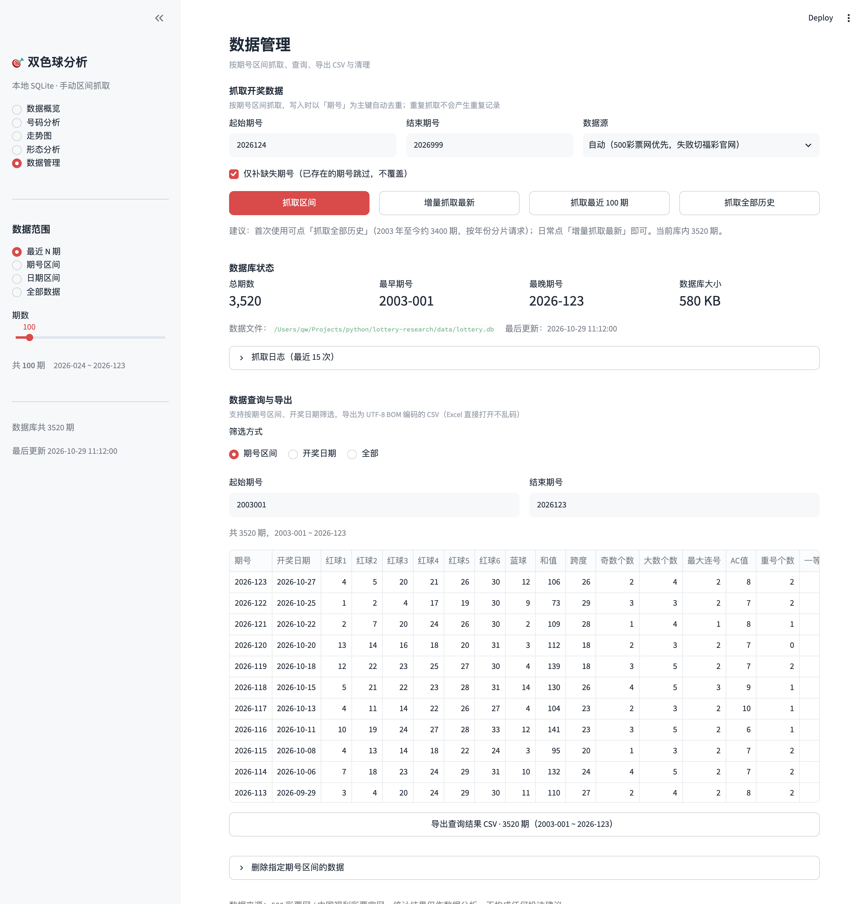

# 双色球数据分析平台

基于 **Streamlit + SQLite + Plotly** 的双色球数据抓取与分析应用。抓取逻辑沿用旧项目（`~/Projects/python/Lottery`）对 500 彩票网历史页的解析方式，但整体结构、数据存储与前端全部重写。

## 功能

**数据抓取**
- 前端手动指定期号区间抓取，按期分片请求并显示进度
- 写入以 `period` 为主键 + `ON CONFLICT` upsert，**重复抓取不会产生重复记录**
- 支持「仅补缺失」（跳过已有期号）、「增量抓最新」、「最近 N 期」、「全部历史（2003 至今）」
- 双数据源：500 彩票网（主）+ 中国福彩官网 JSON 接口（失败自动兜底）

**数据存储**
- 单文件 SQLite（`data/lottery.db`），含开奖记录与抓取日志两张表
- 记录红球、蓝球、奖池、销售额、一/二等奖注数与金额

**可视化**（5 个页面）
- 数据概览：最新一期、近期开奖、号码频率速览、期号精确查询
- 号码分析：红/蓝球出现次数、当前遗漏、冷热对比（近期 vs 全样本）
- 走势图：号码点阵走势（可分三区）、蓝球走势、和值与跨度曲线
- 形态分析：和值/跨度分布、奇偶比、大小比、三区占比、连号、AC 值、重号
- 数据管理：抓取表单、数据库状态、抓取日志、查询与导出、区间删除（**口令保护，默认不在导航里**）

**导出**
- 各页面均可导出 CSV（UTF-8 BOM，Excel 直接打开不乱码），表头为中文

## 界面







## 快速开始

```bash
cd lottery-research
./run.sh
```

`run.sh` 会在首次运行时自动创建项目内的 `.venv` 并安装依赖，之后直接启动。想手动来也行：

```bash
python3 -m venv .venv
.venv/bin/pip install -r requirements.txt      # 或 requirements.lock.txt 复现完全一致的版本
.venv/bin/python -m streamlit run app.py
```

环境：Python 3.13（3.10+ 应该都可以），依赖清单见 `requirements.txt`，实际验证过的版本固定在 `requirements.lock.txt`。

首次打开数据库为空，页面会引导你抓取数据（最近 100 期 / 全部历史 / 自定义区间）。

也可以先用命令行灌数据：

```bash
.venv/bin/python -m lottery.cli crawl --all                 # 2003 年至今全部历史
.venv/bin/python -m lottery.cli crawl --start 2026001 --end 2026123
.venv/bin/python -m lottery.cli crawl --recent 100
.venv/bin/python -m lottery.cli stats
```

（激活过 `.venv` 的话，直接 `python -m lottery.cli ...` 即可。）

## 管理入口与口令

「数据管理」页（抓取、区间删除、全库查询导出）默认**不出现在导航里**，口令正确后才解锁：

- 入口在**侧边栏右下角**，一个很淡的「⋯」按钮，吸附在底部 → 点开输入口令 → 导航里多出「数据管理」
- 解锁后按钮变红、浮层里变成「锁定并退出」，点一下立刻退回「数据概览」，管理页的控件一并消失
- **口令只从环境变量 `LOTTERY_ADMIN_PASSWORD` 注入，代码里没有任何默认值**。没配置时管理页不可达，入口只提示怎么配

配置方式二选一：

```bash
# 1) 项目根目录放 .env（已被 .gitignore 忽略，推荐）
cp .env.example .env
# 编辑 .env：LOTTERY_ADMIN_PASSWORD=你的口令

# 2) 直接给进程注入
LOTTERY_ADMIN_PASSWORD='你的口令' ./run.sh
```

`.env` 由 `lottery/config.py` 里的极简解析器读取（不引额外依赖），已存在的环境变量优先，
不会被文件覆盖。`.env`、`.env.*` 都写进了 `.gitignore`，只保留 `.env.example` 模板。

**刷新后不用重输**：Streamlit 的 `st.session_state` 绑在 websocket 会话上，刷新即丢，
所以解锁成功后会额外写一个 cookie `ssq_admin`，值是口令派生的 HMAC 令牌（不是口令本身），
有效期 7 天。刷新 / 重开标签页时服务端从 `st.context.cookies` 读回来自动恢复解锁；
点「锁定并退出」会把 cookie 一起清掉。**改口令后旧 cookie 自动失效**（令牌由口令派生）。

几点边界：

- 这是**单机自用**的轻量门禁，不是账号体系：口令比对用 `hmac.compare_digest`，支持中文口令
- cookie 里的令牌等同于登录凭证，拿到它就能进；公网部署请上 HTTPS，别在共用电脑上勾记住
- 没配置口令时 `_admin_unlocked()` 恒为 `False`，即使会话里残留 `admin_unlocked=True` 也进不去（fail closed）
- 数据库为空时的引导页（首次抓取）不需要口令，否则没法初始化
- 只读页面（概览 / 号码 / 走势 / 形态）的 CSV 导出不受影响
- 口令只挡界面，不加密数据文件；库文件本身仍是明文的 `data/lottery.db`
- 部署到公网时请用强口令，并确保 `.env` 不进镜像 / 不进仓库

> 附注：Streamlit 右上角原生的 `⋮` 菜单是内置组件，`st.set_page_config(menu_items=...)` 只能改
> Get Help / Report a bug / About 三个条目（纯链接或纯文本），无法插入自定义交互项，
> 所以管理入口用侧边栏内的「⋯」浮层实现。

## 只读数据接口（供 AI / 脚本调用）

`lottery/api.py` 是一层纯函数接口，`lottery/cli.py` 把它暴露成命令。**只读、不写库、stdout 只有 JSON**，可以直接 `json.loads`，也可以让 AI 通过 Skill 调用。

设计原则：

- 统计量一律由代码算，调用方（人或模型）只负责解读，不自己数
- 每个结果都带 `columns`（key / label / type），字段含义不靠外部文档
- 结果统一信封，表格在 `rows`，聚合在 `data`
- 参数与结果都带范围元信息，避免「拿 20 行当全量」

```bash
.venv/bin/python -m lottery.cli schema                          # 接口自描述，AI 第一步调用
.venv/bin/python -m lottery.cli stats                           # 库状态
.venv/bin/python -m lottery.cli query --limit 20                # 最近 20 期
.venv/bin/python -m lottery.cli query --start 2026001 --end 2026123 --order desc
.venv/bin/python -m lottery.cli draw 2026123                    # 单期详情（含奖金）
.venv/bin/python -m lottery.cli analyze frequency --color red --top 10
.venv/bin/python -m lottery.cli analyze omission --color blue --top 10
.venv/bin/python -m lottery.cli analyze hot-cold --window 50 --top 10
.venv/bin/python -m lottery.cli analyze shape --window 100
.venv/bin/python -m lottery.cli analyze overview --window 100
```

输出示例（省略了 `columns`）：

```json
{"ok": true, "title": "开奖记录（3520 期，返回最近 3 期）",
 "meta": {"count": 3, "total": 3520, "truncated": true,
          "range": ["2026121", "2026123"], "requested_range": ["2003001", "2026123"],
          "db_total": 3520, "db_range": ["2003001", "2026123"]},
 "rows": [{"period": "2026123", "draw_date": "2026-10-27",
           "reds": [4, 5, 20, 21, 26, 30], "blue": 12,
           "sum_value": 106, "span": 26, "ac_value": 8, "repeat_count": 2}]}
```

约定：

| 项 | 说明 |
| --- | --- |
| `--format json` / `md` | 默认 JSON（紧凑）；`md` 输出 Markdown 表格，给人看 |
| `--pretty` | 缩进美化 JSON |
| `--limit` | 默认 20，上限 500；截断时 `meta.truncated=true`，`meta.total` 是真实总数 |
| `--window` | 在 `start/end` 区间内只看最近 N 期 |
| `--fields` | 自定义返回字段，逗号分隔；`--no-features` 去掉派生字段，`--prize` 附带奖金 |
| `--db` | 指定其他数据库文件，等价于环境变量 `LOTTERY_DB_PATH` |
| stdout | 只有 JSON；抓取进度和日志一律走 stderr |
| 退出码 | `0` 成功；`2` 参数错误；`3` 数据不存在；`4` 其他错误 |

出错时同样返回可解析的 JSON（`ok=false` + `error.type/message`），不会抛一堆栈出来。

`analyze shape` / `analyze overview` 的返回值放在 `data` 里，例如 `data.sum_value` 是
`{mean, median, std, min, max, p25, p75, distribution, binned}`，`data.zone` 是三区占比数组。

写 Skill 时建议：先跑一次 `schema` 拿到命令清单与字段字典，之后只调命令、不拼 SQL、不读整表 CSV。

## 项目结构

```
lottery-research/
├── app.py                  # Streamlit 入口与页面路由
├── run.sh                  # 一键启动，自动创建 .venv
├── .env.example            # 环境变量模板（复制成 .env 用，.env 已被 git 忽略）
├── requirements.txt        # 依赖声明
├── requirements.lock.txt   # 验证过的精确版本
├── lottery/
│   ├── config.py           # 路径、配色、规则常量
│   ├── models.py           # DrawRecord / CrawlReport 等数据模型
│   ├── db.py               # SQLite 访问层（建表、upsert、查询、日志）
│   ├── analytics.py        # 频率、遗漏、形态特征、冷热、导出
│   ├── api.py              # 只读接口层：纯函数 + 统一 JSON 信封
│   ├── charts.py           # Plotly 图表构造
│   ├── cli.py              # 命令行：抓取 + 只读查询子命令
│   ├── crawler/
│   │   ├── periods.py      # 期号规范化、按年切片
│   │   ├── sources.py      # 500 彩票网 / 福彩官网 数据源
│   │   └── service.py      # 抓取服务（分片、去重、入库、日志）
│   └── ui/                 # 各页面与公共组件
├── data/lottery.db         # 运行后生成
├── .venv/                  # 项目虚拟环境（已创建，git 忽略）
└── docs/                   # 截图
```

分层原则：**数据源**只负责把 HTML/JSON 变成 `DrawRecord`；**服务层**负责分片、去重与入库；**分析层**只做纯函数计算；**接口层**只读、只做序列化（CLI / Skill / 未来的 MCP 共用同一套函数）；**图表层**只接收 DataFrame；**UI 层**不写业务逻辑。

## 去重机制

`draws` 表以 7 位期号 `period` 为主键，写入使用：

```sql
INSERT INTO draws (...) VALUES (...)
ON CONFLICT(period) DO UPDATE SET ...
```

服务层在写入前对同一批数据按期号去重（后者覆盖前者），并逐条比对内容：

| 情况 | 处理 |
| --- | --- |
| 期号不存在 | 新增 |
| 期号存在且字段有变化 | 更新（刷新 `updated_at`） |
| 期号存在且完全一致 | 跳过，不改 `updated_at` |
| 勾选「仅补缺失」且期号已存在 | 直接跳过 |

因此同一区间反复抓取，库内期数不变，只会得到「新增 0 / 未变 N」的结果。

## 期号约定

- 库内统一存 **7 位** `YYYYNNN`（如 `2026123`），展示为 `2026-123`
- 输入兼容 `2026123`、`26123`、`2026-123`
- 500 彩票网接口只接受 5 位写法，调用前自动转换（`to_short_period`）

## 指标口径

| 指标 | 说明 |
| --- | --- |
| 和值 | 6 个红球之和，理论均值 102 |
| 跨度 | 最大红球 − 最小红球 |
| 奇偶比 / 大小比 | 奇数:偶数；大数（17-33）:小数（1-16） |
| 三区 | 一区 1-11、二区 12-22、三区 23-33 |
| 最大连号 | 红球中连续号码的最长长度 |
| AC 值 | 两两差值去重个数 − 5 |
| 重号 | 与上一期重复的红球个数 |
| 当前遗漏 | 该号码距今未开出的期数 |
| 平均遗漏 | (总期数 − 出现次数) / (出现次数 + 1) |
| 冷热 | 近 N 期出现率 − 全样本出现率，≥ +3pp 为热、≤ −3pp 为冷 |

## 说明

- 数据来自公开开奖信息，仅用于数据分析与可视化练习，**不构成任何投注建议**。
- 抓取按年份分片并留有请求间隔，请勿高频调用对方接口。
- 可通过环境变量 `LOTTERY_DB_PATH` 指定其他数据库文件，`LOTTERY_ADMIN_PASSWORD` 指定「数据管理」口令。

## 许可

Apache License 2.0，见 [LICENSE](LICENSE)。
